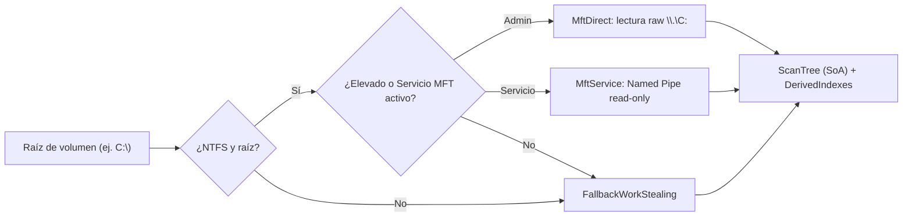

# ScanCleaner — Arquitectura del Motor de Escaneo y Modelo de Datos

Este documento describe la arquitectura nativa en Rust (`src-tauri/src/scanner/`) que permite a ScanCleaner indexar millones de archivos en pocos segundos con bajo consumo de memoria y consultas instantáneas hacia la UI.

---

## 1. Motor de escaneo dual (`src-tauri/src/scanner/`)

ScanCleaner selecciona automáticamente la ruta más rápida disponible para cada volumen (`scan_directory_with_options` en `scanner/mod.rs`):

### Ruta rápida: NTFS MFT directa (`scanner/mft.rs`)
Cuando el proceso corre elevado o a través del servicio opcional de indexación:
1. Abre el volumen con `CreateFileW("\\\\.\\X:", FILE_READ_DATA | FILE_READ_ATTRIBUTES, FILE_SHARE_READ | FILE_SHARE_WRITE | FILE_SHARE_DELETE, ...)` y consulta `FSCTL_GET_NTFS_VOLUME_DATA` (tamaño de sector, cluster, tamaño de registro `FILE`, `MftStartLcn`, `MftValidDataLength`).
2. Lee la `$MFT` secuencialmente en bloques grandes de **8 MB** (`MFT_READ_CHUNK_BYTES`) y parsea los registros `FILE` en paralelo con **Rayon**.
3. En cada registro `FILE`:
   - Aplica y valida el fixup de la **Update Sequence Array (USA)** (descarta sectores corruptos/rasgados de forma segura).
   - Extrae timestamps y atributos de `$STANDARD_INFORMATION`.
   - Extrae nombre y `parent_frn` desde `$FILE_NAME`, prefiriendo siempre nombres **Win32 / Win32+DOS / POSIX** sobre nombres cortos **DOS 8.3** y preservando múltiples hardlinks por padre distinto.
   - Lee tamaño lógico y tamaño asignado exclusivamente desde **`$DATA`** (nunca desde `$FILE_NAME`, cuyos campos pueden quedar obsoletos).
   - Decodifica data runs (`mapping pairs`) para archivos no residentes, **comprimidos** y **sparse**, sumando únicamente clusters reales asignados (ignorando huecos sparse `lcn: None`).
   - Fusiona registros de extensión referenciados mediante **`$ATTRIBUTE_LIST`** en su FRN base antes de construir el árbol.
   - **Hardlinks:** se contabilizan una sola vez (los enlaces adicionales quedan marcados con `NodeFlags::HARDLINK_DUP` y `allocated = 0`).
   - **Alternate Data Streams (ADS):** excluidos por defecto del total; configurables vía `AppSettings.include_ads`.
   - **Placeholders de la nube:** detecta `FILE_ATTRIBUTE_RECALL_ON_DATA_ACCESS`, `FILE_ATTRIBUTE_RECALL_ON_OPEN` y `FILE_ATTRIBUTE_OFFLINE` sin abrir jamás el archivo ni disparar descargas; se marcan con `NodeKind::CloudPlaceholder` y `NodeFlags::CLOUD_ONLY` mostrando su tamaño local real.
   - **Reparse points:** detecta `IO_REPARSE_TAG_MOUNT_POINT` (junctions) e `IO_REPARSE_TAG_SYMLINK` desde `$REPARSE_POINT` y evita descender por ellos.

### Ruta de respaldo: enumeración paralela work-stealing (`scanner/fallback_walk.rs`)
Para volúmenes sin privilegios de administrador, o sistemas de archivos FAT32, exFAT, ReFS y recursos de red:
- Emplea un pool dedicado de Rayon con **work-stealing por directorio** (`rayon::scope`).
- Usa `NtQueryDirectoryFile` (`FileIdBothDirectoryInformation`, clase 37) con buffers grandes de **128 KB** y fallback automático a `FindFirstFileExW` con `FindExInfoBasic` + `FIND_FIRST_EX_LARGE_FETCH`.
- **Cero llamadas `stat` / `GetFileAttributesEx` por archivo:** todos los tamaños, timestamps, atributos y `FileId` salen directamente del buffer de enumeración.
- Nunca sigue junctions ni symlinks; nunca abre contenido de archivos ni hidrata placeholders cloud.
- Emite progreso agregado con throttle a **~10 Hz** (`>= 100 ms`), nunca un evento por archivo.

---

## 2. Modelo de datos Structure-of-Arrays (`scanner/model.rs`)

En lugar de un objeto Rust/heap por archivo, `ScanTree` almacena vectores paralelos contiguos indexados por `NodeId = u32`:

| Columna | Tipo | Propósito |
|---|---|---|
| `parent`, `first_child`, `next_sibling` | `Vec<u32>` | Topología de árbol en lista enlazada compacta |
| `name_offset`, `name_len` | `Vec<u32>`, `Vec<u16>` | Slice UTF-8 dentro de `name_pool: Vec<u8>` (con interning FNV-1a para nombres `<= 32` bytes) |
| `logical_size`, `allocated_size` | `Vec<u64>` | Tamaño lógico y asignado en disco (propagado bottom-up para directorios) |
| `file_count` | `Vec<u32>` | Cantidad de archivos del subárbol |
| `last_write_ts` | `Vec<u32>` | Timestamp Unix compacto |
| `kind`, `type_cat`, `origin_cat` | `Vec<u8>` | Tipo de nodo y categorías |
| `flags` | `Vec<u16>` | Bitflags (`NodeFlags`: hardlink, sparse, compressed, cloud, protected, optimistic_hidden, tombstone) |
| `file_ref` + `frn_to_node` | `Vec<u64>` + `HashMap<u64, u32>` | Mapeo instantáneo FRN NTFS ↔ `NodeId` para deltas USN |

---

## 3. Índices derivados en una sola pasada y actualización incremental (`scanner/derived.rs`)

Durante la misma pasada bottom-up de finalización (`finalize_tree_and_derived`), sin pasadas extra sobre el disco, se construyen y mantienen:
- **Totales por categoría** (`type_totals`, `origin_totals`).
- **Top 400 archivos y carpetas más grandes** (`top_files`, `top_dirs`).
- **Índice de artefactos de desarrollo** (`dev_artifacts`): carpetas que hacen match con el catálogo de *Limpieza Dev* junto con el manifest detectado (`package.json`, `Cargo.toml`, `composer.json`, etc.).
- **Índice de cachés globales** (`global_caches`) y carpetas de staging pendientes (`pending_trash_nodes`).
- **Protección precalculada** (`NodeFlags::PROTECTED` y `PROTECTED_DESCENDANT`) propagada hacia arriba usando `ProtectionEngine::is_protected()`.

Al recibir deltas del USN o reconciliaciones de subárbol, `refresh_derived_for_subtree` actualiza solo la rama tocada y mantiene coherentes todos los índices derivados.

---

## 4. Comunicación escaneo ↔ UI y Treemap nativo

- El árbol completo **nunca** cruza IPC. La UI consulta bajo demanda:
  - `cmd_get_treemap_layout`: calcula el layout squarified en Rust (`scanner/treemap_layout.rs`), descarta rectángulos menores a `min_px` (3 px por defecto) y devuelve únicamente los rectángulos visibles para dibujar en `<canvas>` 2D.
  - `cmd_get_top_entries`: devuelve los Top N hijos/archivos del ámbito actual.
  - `cmd_search_volume`: búsqueda incremental sobre el `name_pool`.
  - `cmd_discover_cleanup_candidates` y `cmd_dev_scan`: leen directamente de `DerivedIndexes` (con caché persistida de CLIs dev y `git check-ignore --stdin` por repo), logrando aperturas instantáneas.
