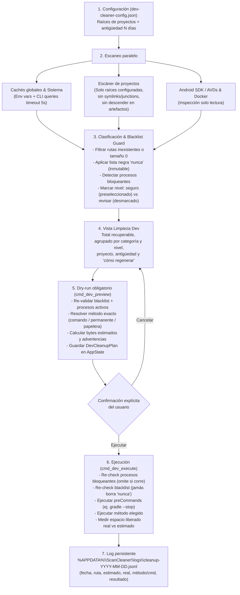

# Plan de Arquitectura e Implementación — Modo "Limpieza Dev"

## 0. Resumen y decisiones acordadas

El objetivo es incorporar un modo **"Limpieza Dev"** a ScanCleaner que detecte y limpie **exclusivamente archivos regenerables y acumulados de desarrollo** (Node, PHP, Python, Android, Docker, IDE, Sistema y Testing) con niveles de seguridad, reglas declarativas, precondiciones de procesos, dry-run obligatorio, medición real vs estimada y registro auditable, sin tocar nunca código fuente ni datos.

### Decisiones de diseño confirmadas
1. **Integración en la UI**: Nueva pestaña dedicada **"Limpieza Dev"** en el menú lateral (`dev_cleaner`), manteniendo la vista actual `Limpieza segura` (`CleanerView.tsx`) intacta y sin refactorizar su flujo.
2. **Motor de reglas y configuración**: Catálogo declarativo en JSON embebido en el binario Rust (`include_str!`), combinado con configuración de usuario en `%APPDATA%\ScanCleaner\dev-cleaner-config.json` (raíces de proyectos, días de antigüedad, reglas desactivadas).
3. **Selector de carpetas raíz de proyectos**: Diálogo nativo de Windows mediante `IFileOpenDialog` (`FOS_PICKFOLDERS`) usando `windows-rs` (ya presente en `Cargo.toml`) + campo de texto manual para pegar/añadir rutas, sin introducir dependencias externas.
4. **Proyectos sin repositorio Git**: Si un proyecto cumple manifest válido y antigüedad pero no es un repo Git (no tiene `.git`), se incluye en nivel `revisar` (desmarcado por defecto) con una insignia visible **"Sin repo Git"**. Si sí es repo Git, `git check-ignore` es obligatorio y excluye cualquier carpeta no ignorada.
5. **CLIs oficiales ausentes o con timeout**: En escaneo se consulta el CLI oficial con timeout corto (~5 s, leyendo `stdout` y tomando la última línea con ruta válida para tolerar avisos como Corepack). Si el CLI no está en `PATH`, se hace fallback a la ruta por variable de entorno y se degrada a borrado directo con aviso **"CLI no encontrado"** únicamente para cachés de archivo (nunca para Docker, `sdkmanager` ni `DISM`).
6. **Log persistente**: Se reutiliza el archivo JSONL diario existente (`%APPDATA%\ScanCleaner\logs\cleanup-YYYY-MM-DD.jsonl`) extendiendo `CleanupLogEntry` con campos opcionales retrocompatibles (`#[serde(default)]`: `rule_id`, `estimated_bytes`, `command`) para que `HistoryView.tsx` muestre las limpiezas Dev automáticamente.

---

## 1. Encaje con la arquitectura actual

Se reutilizan `cleaner::guardrails`, `cleaner::executor` (eliminación segura, `IFileOperation` STA, `SHEmptyRecycleBinW`), `elevation::is_elevated`, `storage` (logs JSONL y `app_data_dir()`) y `windows-rs` (`CreateToolhelp32Snapshot`, `GetFileAttributesW`, `IFileOpenDialog`).

### Módulos y archivos NUEVOS

#### Backend Rust (`src-tauri/src/`)
| Archivo | Responsabilidad |
| :--- | :--- |
| `src-tauri/src/dev_cleaner/mod.rs` | Punto de entrada del módulo `dev_cleaner`, re-exporta subcomponentes y tipos DTO públicos. |
| `src-tauri/src/dev_cleaner/rules.json` | Catálogo declarativo embebido vía `include_str!("rules.json")` con todas las reglas (`cache-global`, `artefacto-proyecto`, `sistema`, `android-sdk`, `docker`) y la lista negra inmutable de nivel `nunca`. |
| `src-tauri/src/dev_cleaner/schema.rs` | Estructuras Rust (`DevRule`, `RuleCategory`, `RuleKind`, `SafetyLevel`, `CleanMethod`, `Precondition`, `BlacklistSpec`, `DevCleanerConfig`, `DevScanReport`, `DevCandidate`, `DevCleanupPlan`, `DevCleanupResult`) y carga/validación de `rules.json` + `%APPDATA%\ScanCleaner\dev-cleaner-config.json`. |
| `src-tauri/src/dev_cleaner/blacklist.rs` | Guardrails específicos de Limpieza Dev que envuelven `cleaner::guardrails::validate_target_path` y aplican la lista negra `nunca` (código fuente, `.git`, `.env*`, `*.jks`, `*.keystore`, `local.properties`, volúmenes Docker, carpetas de BD locales y cualquier ruta fuera del catálogo). Prevalece sobre cualquier regla. |
| `src-tauri/src/dev_cleaner/process.rs` | Detección de procesos bloqueantes en ejecución (`CreateToolhelp32Snapshot`, reutilizando el patrón de `cleaner::detectors::detect_running_browsers`) y abstracción `CommandRunner` (trait mockeable para tests) con timeout para consultas CLI (`npm`, `pnpm`, `yarn`, `pip`, `git`, `sdkmanager`, `docker`, `gradle --stop`, `DISM`). |
| `src-tauri/src/dev_cleaner/resolver.rs` | Resolución dinámica de rutas vía variables de entorno (`%LOCALAPPDATA%`, `%APPDATA%`, `%USERPROFILE%`, `%TEMP%`, `%SystemRoot%`, `%ANDROID_HOME%`, `%ANDROID_SDK_ROOT%`) y consultas CLI reales. Verificación de existencia en disco, detección de `workspaceStorage` huérfanos en VS Code, versiones duplicadas de extensiones VS Code, carpetas de versiones viejas de Android Studio/JetBrains, SDK Android y AVDs. |
| `src-tauri/src/dev_cleaner/project_scanner.rs` | Escáner acotado a las raíces de proyectos configuradas por el usuario. No sigue symlinks ni junctions (`is_reparse_point`), no desciende dentro de un artefacto detectado, valida manifest requerido, ejecuta `git check-ignore` si hay `.git` y calcula antigüedad real del proyecto (último commit Git o `mtime` máximo de archivos fuente, nunca del artefacto). |
| `src-tauri/src/dev_cleaner/executor.rs` | Construcción del `DevCleanupPlan` (dry-run obligatorio) y ejecución real: verificación de precondiciones/procesos bloqueantes (omite con aviso sin forzar), ejecución de `pre_commands` (ej. `gradle --stop`), comandos oficiales, borrado permanente seguro (por defecto en artefactos regenerables) o Papelera opcional (`IFileOperation`), medición de espacio real liberado (tamaño antes − tamaño después o delta de volumen/output de CLI) y escritura en JSONL. |
| `src-tauri/src/dev_cleaner/folder_picker.rs` | Selector nativo de carpetas Win32 usando `IFileOpenDialog` con `FOS_PICKFOLDERS` en hilo COM STA. |
| `src-tauri/tests/dev_cleaner_tests.rs` | Suite de tests de integración con fixtures en `TempDir` (con/sin manifest, git ignorado/no ignorado, reciente/antiguo, rutas `nunca`, procesos bloqueantes y `MockCommandRunner` sin limpiezas reales). |

#### Frontend React + TypeScript (`src/`)
| Archivo | Responsabilidad |
| :--- | :--- |
| `src/pages/DevCleanerView.tsx` | Vista "Limpieza Dev": configuración de raíces de proyectos y días de antigüedad, total recuperable, agrupación por categoría y nivel (`seguro` preseleccionado, `revisar` desmarcado), badges de proceso bloqueante / admin / "Sin repo Git", antigüedad y "cómo regenerar", y tarjeta informativa de compactación Docker/WSL. |
| `src/components/DevCleanupModal.tsx` | Modal de Dry-run obligatorio (resumen de ítems, método exacto o comando oficial, cambio opcional Permanente ↔ Papelera para artefactos regenerables, advertencias y bloqueados) + pantalla de resultado comparando **espacio liberado real vs estimado**. |

### Archivos EXISTENTES que se tocan (con justificación)

> [!IMPORTANT]
> Ningún archivo existente se refactoriza. Solo se realizan adiciones mínimas y retrocompatibles para registrar el nuevo módulo, sus comandos IPC, los campos opcionales del log y la nueva pestaña en la UI.

| Archivo existente | Cambio exacto | Justificación |
| :--- | :--- | :--- |
| `src-tauri/src/lib.rs` | Agregar `pub mod dev_cleaner;` y registrar los nuevos comandos `cmd_dev_*` en `tauri::generate_handler!`. | Exponer el módulo y sus comandos IPC a Tauri. |
| `src-tauri/src/state.rs` | Añadir `pub pending_dev_plans: Mutex<HashMap<String, DevCleanupPlan>>` en `AppState`. | Mantener los planes de dry-run Dev aislados de `pending_plans` del limpiador general. |
| `src-tauri/src/commands/mod.rs` | Añadir handlers `cmd_dev_get_config`, `cmd_dev_save_config`, `cmd_dev_pick_project_root`, `cmd_dev_scan`, `cmd_dev_preview`, `cmd_dev_execute`. | Centralizar comandos IPC siguiendo la convención actual del repo. |
| `src-tauri/src/cleaner/executor.rs` | Hacer `pub(crate)` las funciones internas `delete_to_recycle_bin_sta` y `remove_permanently_safe` (sin cambiar su lógica). | Reutilizar exactamente los mismos mecanismos de borrado seguro y COM STA sin duplicar código Win32. |
| `src-tauri/src/storage/mod.rs` | Añadir campos opcionales con `#[serde(default, skip_serializing_if = "Option::is_none")]` a `CleanupLogEntry`: `rule_id: Option<String>`, `estimated_bytes: Option<u64>`, `command: Option<String>`. | Retrocompatibilidad total con logs existentes mientras se registra método/comando y estimado vs real en el mismo JSONL. |
| `src-tauri/Cargo.toml` | Verificar si la feature `Win32_UI_Shell` ya incluye `IFileOpenDialog` / `FOS_PICKFOLDERS` (si falta `Win32_System_Com_StructuredStorage`, añadir solo esa feature). | Habilitar el selector nativo de carpetas con `windows-rs`. |
| `src/lib/ipc.ts` | Añadir interfaces TS y wrappers `api.dev*` para los nuevos comandos IPC y campos opcionales en `CleanupLogEntry`. | Mantener la capa IPC tipada en un único archivo. |
| `src/App.tsx` | Añadir `"dev_cleaner"` a `NavPage`, una entrada en `navItems` (`Limpieza Dev` con icono `Terminal` o `Code2`) y renderizar `<DevCleanerView />`. | Integrar la nueva pestaña sin tocar `CleanerView.tsx`. |

---

## 2. Esquema del archivo de reglas y catálogo validado en Windows

### Esquema JSON declarativo (`src-tauri/src/dev_cleaner/rules.json`)

```json
{
  "schemaVersion": 1,
  "blacklistNever": {
    "exactNames": [".git", "local.properties"],
    "globPatterns": [".env", ".env.*", "*.jks", "*.keystore"],
    "dbDirNames": ["pgdata", "mysql", "mariadb", "mongodb", "data\\db", "sqlite"],
    "sourceExtensions": [
      "rs", "ts", "tsx", "js", "jsx", "py", "php", "java", "kt", "kts",
      "cs", "go", "c", "cpp", "h", "hpp", "swift", "dart", "sql", "md"
    ],
    "forbidDockerVolumes": true
  },
  "rules": [
    {
      "id": "node-npm-cache",
      "nombre": "Caché global de npm",
      "categoria": "Node",
      "tipo": "cache-global",
      "ubicacion": {
        "cliQuery": ["npm", "config", "get", "cache"],
        "envFallback": ["%LOCALAPPDATA%\\npm-cache"]
      },
      "deteccion": {
        "requiredMarkers": [],
        "mustExist": true
      },
      "nivel": "seguro",
      "metodo": {
        "tipo": "comando-oficial",
        "comando": ["npm", "cache", "clean", "--force"],
        "fallbackBorradoSiSinCli": true
      },
      "precondiciones": {
        "blockingProcesses": ["node.exe"],
        "preCommands": [],
        "requiresAdmin": false
      },
      "comoRegenerar": "Se regenera automáticamente en el próximo `npm install`."
    }
  ]
}
```

#### Campos soportados en cada regla
- `id` (`string`): identificador único estable.
- `nombre` (`string`): etiqueta legible en UI.
- `categoria`: `"Node" | "PHP" | "Python" | "Android" | "Docker" | "IDE" | "Sistema" | "Testing"`.
- `tipo`: `"cache-global" | "artefacto-proyecto" | "sistema"`.
- `ubicacion`:
  - Para `cache-global` / `sistema`: `{ cliQuery?: string[], envFallback: string[], globSubdirs?: string, specialDetector?: "vscode_orphan_ws" | "vscode_old_exts" | "android_studio_old" | "android_sdk_unused" | "android_avds" | "gradle_old_dists" | "gradle_daemon_logs" | "recycle_bin" | "docker_prune" | "dism_cleanup" }`.
  - Para `artefacto-proyecto`: `{ folderPatterns: string[] }` (p. ej. `["node_modules"]`, `["build", "app\\build"]`).
- `deteccion`: `{ requiredMarkers: string[], requireGitIgnoredIfRepo: boolean, requireProjectAgeDays: boolean }`.
- `nivel`: `"seguro" | "revisar" | "nunca"`.
- `metodo`: `{ tipo: "comando-oficial" | "borrado-permanente" | "papelera", comando?: string[], fallbackBorradoSiSinCli?: boolean, allowRecycleBinOption?: boolean }`.
- `precondiciones`: `{ blockingProcesses: string[], preCommands: string[][], requiresAdmin: boolean }`.
- `comoRegenerar` (`string`): texto mostrado en UI y dry-run.

---

### Catálogo inicial validado en Windows

Estado de validación en esta máquina Windows:
- **Validado**: CLI y/o ruta comprobada directamente en este entorno.
- **A verificar**: herramienta no instalada en este equipo; la ruta y el comando siguen la documentación oficial de Windows y quedan marcados para verificación en entorno con la herramienta instalada.

#### A. Cachés globales (nivel `seguro`, salvo lo indicado)

| ID | Categoría | Nombre | Resolución (CLI → Fallback env) | Método | Precondiciones | Estado en Windows |
| :--- | :--- | :--- | :--- | :--- | :--- | :--- |
| `node-npm-cache` | Node | Caché de npm | `npm config get cache` → `%LOCALAPPDATA%\npm-cache` | `npm cache clean --force` | `node.exe` | **Validado** (`C:\Users\...\AppData\Local\npm-cache`) |
| `node-pnpm-store` | Node | Store de pnpm | `pnpm store path` → `%LOCALAPPDATA%\pnpm\store` | `pnpm store prune` | `node.exe` | **Validado** (`pnpm store path` devolvió `E:\.pnpm-store\v11`; además existe `%LOCALAPPDATA%\pnpm\store`) |
| `node-yarn-cache` | Node | Caché de Yarn | `yarn cache dir` (última línea válida) → `%LOCALAPPDATA%\Yarn\Cache` | `yarn cache clean` | `node.exe` | **Validado** (ojo: Corepack imprime aviso previo en salida; ruta real `%LOCALAPPDATA%\Yarn\Cache\v6`) |
| `node-bun-cache` | Node | Caché de Bun | `bun pm cache` → `%USERPROFILE%\.bun\install\cache` | `bun pm cache rm` | `bun.exe` | **A verificar** (Bun no instalado aquí) |
| `py-pip-cache` | Python | Caché de pip | `pip cache dir` → `%LOCALAPPDATA%\pip\Cache` | `pip cache purge` | `python.exe` | **Validado** (`%LOCALAPPDATA%\pip\Cache`) |
| `py-uv-cache` | Python | Caché de uv | `uv cache dir` → `%LOCALAPPDATA%\uv\cache` | `uv cache clean` | `uv.exe`, `python.exe` | **A verificar** (uv no instalado aquí) |
| `py-poetry-cache` | Python | Caché de Poetry | `poetry config cache-dir` → `%LOCALAPPDATA%\pypoetry\Cache` | `poetry cache clear --all .` *(a verificar flag interactivo `-n`)* | `python.exe` | **A verificar** (Poetry no instalado aquí) |
| `php-composer-cache` | PHP | Caché de Composer | `composer config cache-dir` → `%LOCALAPPDATA%\Composer` | `composer clear-cache` | `php.exe` | **A verificar** (Composer no instalado aquí) |
| `android-gradle-caches` | Android | Cachés de Gradle | `%USERPROFILE%\.gradle\caches` | `borrado-permanente` | Pre: `gradle --stop` (si existe); bloquea: `studio64.exe`, `java.exe` (GradleDaemon) | **Validado** (carpeta existe) |
| `android-gradle-daemon-logs` | Android | Logs de daemon Gradle | `%USERPROFILE%\.gradle\daemon\*\*.log` | `borrado-permanente` | Pre: `gradle --stop`; bloquea: `studio64.exe` | **Validado** (carpeta `daemon` existe) |
| `android-gradle-wrapper-dists` | Android | Distribuciones viejas de Gradle wrapper | `%USERPROFILE%\.gradle\wrapper\dists` (conservar la más reciente por uso/mtime) | `borrado-permanente` | Pre: `gradle --stop`; bloquea: `studio64.exe` | **Validado** (carpeta `wrapper\dists` existe) |
| `java-maven-repo` | Android | Repositorio local Maven *(nivel `revisar`)* | `%USERPROFILE%\.m2\repository` | `borrado-permanente` | `java.exe`, `studio64.exe`, `idea64.exe` | **A verificar** (`.m2` no existe aquí) |
| `dotnet-nuget-cache` | Sistema | Cachés de NuGet | `dotnet nuget locals all --list` → `%USERPROFILE%\.nuget\packages` | `dotnet nuget locals all --clear` | `dotnet.exe`, `devenv.exe` | **A verificar** (`dotnet` no instalado aquí) |
| `test-playwright` | Testing | Navegadores de Playwright | `%PLAYWRIGHT_BROWSERS_PATH%` → `%LOCALAPPDATA%\ms-playwright` | `borrado-permanente` | `node.exe` | **Validado** (`%LOCALAPPDATA%\ms-playwright` existe) |
| `test-cypress` | Testing | Caché de Cypress | `%CYPRESS_CACHE_FOLDER%` → `%LOCALAPPDATA%\Cypress\Cache` | `borrado-permanente` | `Cypress.exe`, `node.exe` | **A verificar** (no existe aquí) |
| `test-puppeteer` | Testing | Caché de Puppeteer | `%PUPPETEER_CACHE_DIR%` → `%USERPROFILE%\.cache\puppeteer` | `borrado-permanente` | `node.exe` | **A verificar** (no existe aquí) |
| `node-gyp-cache` | Node | Caché de node-gyp | `%LOCALAPPDATA%\node-gyp\Cache` | `borrado-permanente` | `node.exe` | **A verificar** (no existe aquí) |
| `node-electron-cache` | Node | Caché de Electron | `%LOCALAPPDATA%\electron\Cache` | `borrado-permanente` | `electron.exe`, `node.exe` | **A verificar** (no existe aquí) |
| `ide-vscode-caches` | IDE | Cachés y logs de VS Code | `%APPDATA%\Code\{Cache,CachedData,CachedExtensionVSIXs,logs}` | `borrado-permanente` | `Code.exe` | **Validado** (las 4 carpetas existen) |
| `ide-vscode-orphan-ws` | IDE | `workspaceStorage` huérfanos de VS Code | `%APPDATA%\Code\User\workspaceStorage\*` (leyendo `workspace.json` y verificando si la carpeta destino ya no existe) | `borrado-permanente` | `Code.exe` | **Validado** (estructura `<hash>\workspace.json` confirmada) |
| `ide-vscode-old-exts` | IDE | Versiones duplicadas viejas de extensiones VS Code | `%USERPROFILE%\.vscode\extensions` (mismo `publisher.name`, versiones anteriores a la más alta/activa en `extensions.json`) | `borrado-permanente` | `Code.exe` | **Validado** (carpeta existe; parseo de `extensions.json` a verificar con casos múltiples) |
| `ide-android-studio-cache` | IDE | Cachés y logs de Android Studio / JetBrains | `%LOCALAPPDATA%\Google\AndroidStudio*\{caches,log}` y `%LOCALAPPDATA%\JetBrains\*\{caches,log}` | `borrado-permanente` | `studio64.exe`, `idea64.exe`, `webstorm64.exe`, `phpstorm64.exe`, `pycharm64.exe` | **Validado** (`AndroidStudio2026.1.3` existe; nota: JetBrains/AS usa `log` en singular y también se comprueba `logs`) |
| `ide-android-studio-old-ver` | IDE | Versiones antiguas de Android Studio / JetBrains *(nivel `revisar`)* | Carpetas `%LOCALAPPDATA%\Google\AndroidStudio*` y `%LOCALAPPDATA%\JetBrains\*` cuya versión ya no está instalada (cruzando contra registro `Uninstall` / rutas de instalación) | `borrado-permanente` | `studio64.exe`, IDEs JetBrains | **A verificar** (correlación exacta versión↔instalación en Registro) |

#### B. Artefactos de proyecto (nivel `revisar`, borrado permanente por defecto con Papelera opcional)

Condiciones obligatorias para TODOS:
1. Existe al menos uno de los manifests requeridos en la raíz del proyecto (directorio padre de la carpeta artefacto).
2. Si el proyecto pertenece a un repo Git (`.git` presente en el proyecto o ancestro dentro de la raíz configurada), `git check-ignore -q <ruta>` debe retornar código `0`. Si NO está ignorada, se **excluye**. Si el proyecto NO es repo Git, se incluye como `revisar` con insignia `"Sin repo Git"`.
3. Antigüedad >= `N` días (configurable, default `30`), calculada usando el último commit (`git log -1 --format=%ct`) si es repo Git, o el `mtime` más reciente de los archivos fuente (excluyendo el propio artefacto y `.git`).

| ID | Categoría | Carpetas patrón | Manifests requeridos | Cómo regenerar |
| :--- | :--- | :--- | :--- | :--- |
| `proj-node-modules` | Node | `node_modules` | `package.json` | `npm install` / `pnpm install` / `yarn` |
| `proj-web-builds` | Node | `.next`, `.nuxt`, `.turbo`, `.vite`, `.parcel-cache`, `dist`, `coverage` | `package.json` | `npm run build` / `npm test` |
| `proj-php-vendor` | PHP | `vendor` | `composer.json` | `composer install` |
| `proj-py-venv` | Python | `.venv`, `venv` | `pyproject.toml`, `requirements.txt`, `setup.py`, `Pipfile` | `python -m venv .venv && pip install -r requirements.txt` |
| `proj-py-caches` | Python | `__pycache__`, `.pytest_cache`, `.mypy_cache` | `pyproject.toml`, `requirements.txt`, `setup.py`, `*.py` | Se regenera al ejecutar Python / pytest / mypy |
| `proj-android-build` | Android | `build`, `app\build`, `.gradle`, `.cxx` | `build.gradle`, `build.gradle.kts`, `settings.gradle`, `settings.gradle.kts` | `./gradlew assembleDebug` o Sync en Android Studio |
| `proj-dotnet-bin-obj` | Sistema | `bin`, `obj` | `*.csproj`, `*.fsproj`, `*.vbproj` | `dotnet build` |
| `proj-rust-maven-target` | Sistema | `target` | `Cargo.toml`, `pom.xml` | `cargo build` / `mvn compile` |

#### C. Android SDK y emuladores (nivel `revisar`)

| ID | Categoría | Detección | Método | Precondiciones | Estado en Windows |
| :--- | :--- | :--- | :--- | :--- | :--- |
| `android-sdk-unused` | Android | SDK en `%ANDROID_HOME%` → `%ANDROID_SDK_ROOT%` → `%LOCALAPPDATA%\Android\Sdk`. Inspecciona `build-tools`, `platforms`, `ndk`, `system-images` y cruza versiones usadas en proyectos configurados (`compileSdk`, `buildToolsVersion`, `ndkVersion`) para detectar versiones viejas no referenciadas. | **Solo** `sdkmanager.bat --uninstall "<pkg>"` (ubicado en `PATH` o `<SDK>\cmdline-tools\*\bin\sdkmanager.bat`). **Nunca** borrado manual. Si `sdkmanager` no está instalado, se muestra como informativo/bloqueado ("Instala Android SDK Command-line Tools"). | `studio64.exe`, `qemu-system-x86_64.exe`, `emulator.exe` | **Validado parcialmente** (`%LOCALAPPDATA%\Android\Sdk` existe con `build-tools`, `platforms`, `system-images`, pero `cmdline-tools` no está instalado en este equipo; salida exacta de `sdkmanager --list_installed` queda **a verificar**) |
| `android-avds` | Android | `%USERPROFILE%\.android\avd\*.avd` + `<nombre>.ini`. Muestra tamaño real y fecha de último uso (`mtime` de `*.img` / `userdata-qemu.img` / `cache.img`). | Selección explícita únicamente; elimina `<nombre>.avd` y `<nombre>.ini` (o `avdmanager delete avd -n <nombre>` si existe). | `emulator.exe`, `qemu-system-x86_64.exe`, `studio64.exe` | **Validado** (`Medium_Phone.avd` + `Medium_Phone.ini` presentes) |

#### D. Docker / WSL (nivel `revisar`)

| ID | Categoría | Detección | Método | Precondiciones | Estado en Windows |
| :--- | :--- | :--- | :--- | :--- | :--- |
| `docker-builder-prune` | Docker | `docker system df --format json` (verifica si daemon responde) | `docker builder prune -f` | `docker` daemon activo (si está detenido, avisa y omite) | **Validado CLI** (`docker` 29.9.3 instalado; formato JSON de `system df` **a verificar** con daemon activo) |
| `docker-dangling-images` | Docker | Imágenes `<none>` vía `docker images -f dangling=true` | `docker image prune -f` | `docker` daemon activo | **A verificar** con daemon activo |
| `docker-stopped-containers` | Docker | Contenedores `exited` vía `docker ps -a -f status=exited` | `docker container prune -f` | `docker` daemon activo | **A verificar** con daemon activo |
| *(Acción informativa aparte)* | Docker | Compactación de disco virtual Docker/WSL (`ext4.vhdx`) | **Nunca automática**. Tarjeta/acción separada explicando que el `.vhdx` no se reduce tras el `prune`, con pasos guiados (`wsl --shutdown` + `Optimize-VHD` en PowerShell Admin si hay Hyper-V, o `diskpart` `compact vdisk`). | Admin / Hyper-V según método | **Validado** (comportamiento estándar de WSL2/Docker Desktop) |

> [!CAUTION]
> **Prohibición explícita en Docker**: Jamás se ejecutará `docker system prune --volumes` ni `docker volume prune` bajo ninguna circunstancia.

#### E. Sistema (nivel `seguro`, salvo lo marcado)

| ID | Categoría | Ubicación | Nivel | Método | Admin | Estado en Windows |
| :--- | :--- | :--- | :--- | :--- | :---: | :--- |
| `sys-user-temp` | Sistema | `%TEMP%` (contenido interno, no la carpeta raíz) | `seguro` | `borrado-permanente` (Papelera opcional) | No | **Validado** |
| `sys-win-temp` | Sistema | `%SystemRoot%\Temp` (contenido interno) | `seguro` | `borrado-permanente` | **Sí** | **Validado** |
| `sys-crash-dumps` | Sistema | `%LOCALAPPDATA%\CrashDumps` y `%SystemRoot%\Minidump` (este último solo con Admin) | `seguro` | `borrado-permanente` | Parcial (`Minidump` sí) | **A verificar** (`CrashDumps` no existe actualmente aquí; `guardrails.rs` requiere permitir explícitamente `%SystemRoot%\Minidump\*` si se incluye, o limitar a `%LOCALAPPDATA%\CrashDumps` — ver sección 5) |
| `sys-wer-reports` | Sistema | `%LOCALAPPDATA%\Microsoft\Windows\WER` y `C:\ProgramData\Microsoft\Windows\WER\{ReportArchive,ReportQueue,Temp}` | `seguro` | `borrado-permanente` | Parcial (`ProgramData` sí) | **Validado** (`C:\ProgramData\Microsoft\Windows\WER\{ReportArchive,ReportQueue,Temp}` existe) |
| `sys-recycle-bin` | Sistema | Papelera del sistema (`SHQueryRecycleBinW`) | `seguro` | `SHEmptyRecycleBinW` | No | **Validado** (ya implementado) |
| `sys-dism-cleanup` | Sistema | WinSxS vía servicio oficial (sin acceso directo a disco) | `revisar` | `DISM.exe /Online /Cleanup-Image /StartComponentCleanup` | **Sí** | **A verificar** tiempo de ejecución y código de salida en Windows 11 |

#### F. Nivel `nunca` (Lista negra inmutable — prevalece sobre cualquier regla)
Se evalúa en `dev_cleaner::blacklist` **tanto en escaneo como en dry-run y justo antes de ejecutar**:
1. Todo lo bloqueado por `cleaner::guardrails::validate_target_path` (raíces de unidad, `Windows` salvo excepciones exactas, `System32`, `SysWOW64`, `WinSxS`, `Program Files`, `ProgramData` raíz, `Users`, `%USERPROFILE%`, Desktop/Documents/Pictures/Videos/Music, `pagefile.sys`, `hiberfil.sys`, `swapfile.sys`, segmentos `..`, reparse points / junctions / symlinks).
2. Código fuente (archivos con extensiones de código fuera de un artefacto confirmado o carpetas raíz de proyecto).
3. `.git` (directorio o cualquier archivo interior).
4. `.env` y `.env.*` (secretos locales).
5. `*.jks`, `*.keystore` (claves de firma Android/Java).
6. `local.properties` (configuración local de SDK Android).
7. Volúmenes de Docker (nunca `--volumes` ni `volume prune`, y bloqueo de rutas `docker_data`/`volumes`).
8. Carpetas de bases de datos locales (`pgdata`, `mysql`, `mariadb`, `mongodb`, `data\db`, archivos `.sqlite`/`.db` fuera de cachés explícitas de VS Code).
9. Cualquier ruta del sistema que no corresponda a una regla declarada en el catálogo.

---

## 3. Flujo: Escaneo → Clasificación → Dry-run → Ejecución → Log



### Detalles clave de cada etapa
1. **Escaneo de proyectos (`project_scanner.rs`)**:
   - Recorre exclusivamente las raíces configuradas en `dev-cleaner-config.json`.
   - Antes de entrar a cada directorio verifica `is_reparse_point(&dir)`; si es junction o symlink, se omite sin descender.
   - Si un directorio coincide con un patrón de artefacto (`node_modules`, `.next`, `vendor`, `.venv`, `build`, `target`, etc.), verifica los manifests en su carpeta padre. Si coincide:
     - Calcula el tamaño del artefacto con un walker que tampoco sigue reparse points **y NO busca sub-proyectos dentro del artefacto**.
     - Verifica si el proyecto está bajo `.git` → ejecuta `git check-ignore -q <artefacto>`. Si retorna `!= 0`, lo descarta.
     - Calcula antigüedad: si es repo Git, `git log -1 --format=%ct` en la raíz del repo; si no (o repo sin commits), `mtime` máximo de los archivos del proyecto excluyendo artefactos y `.git`. Si antigüedad `< min_age_days`, lo descarta.
2. **Medición de espacio liberado real vs estimado**:
   - Para borrado de rutas (permanente o Papelera): mide bytes de la ruta inmediatamente antes y bytes remanentes después (si hubo archivos bloqueados parciales, `real = antes - despues`).
   - Para comandos oficiales sobre una caché con ruta conocida (`npm`, `pnpm`, `yarn`, `pip`, `uv`, `composer`, `nuget`): mide el tamaño de la carpeta de caché antes y después de ejecutar el comando (`real = antes.saturating_sub(despues)`).
   - Para Docker / DISM: parsea el espacio reportado por `docker ... prune` ("Total reclaimed space: ...") o consulta el delta de espacio libre del volumen (`GetDiskFreeSpaceExW`) como referencia, indicándolo claramente en la UI.

---

## 4. Matriz de permisos (Admin vs Usuario normal)

| Regla / Acción | ¿Requiere Admin? | Sin Admin (`asInvoker`) | Con Admin (elevado vía `ElevationBanner`) |
| :--- | :---: | :--- | :--- |
| Cachés globales de usuario (`npm`, `pnpm`, `yarn`, `bun`, `pip`, `uv`, `poetry`, `composer`, `gradle`, `maven`, `nuget`, `Playwright`, `Cypress`, `Puppeteer`, `node-gyp`, `Electron`) | **No** | Completo. | Completo. |
| Cachés/logs/extensiones de VS Code y Android Studio / JetBrains | **No** | Completo (omite si el IDE está abierto). | Completo. |
| Artefactos de proyecto (`node_modules`, `vendor`, `.venv`, `build`, `target`, `bin/obj`, etc.) | **No** | Completo. | Completo. |
| Android SDK (`sdkmanager --uninstall`) y AVDs | **No** | Completo (salvo SDK instalado en `C:\Program Files`, caso raro que mostraría aviso de permisos). | Completo. |
| Docker (`builder prune`, `image prune`, `container prune`) | **No** *(usuario en grupo `docker-users`)* | Completo si el usuario tiene acceso al pipe de Docker Desktop. | Completo. |
| Compactación `.vhdx` de Docker/WSL | **Sí** *(instrucción aparte)* | Muestra guía paso a paso + comando copiables para PowerShell Admin (`Optimize-VHD` / `diskpart`). | Igual (acción manual guiada por seguridad). |
| `%TEMP%`, `%LOCALAPPDATA%\CrashDumps`, `%LOCALAPPDATA%\Microsoft\Windows\WER`, Papelera | **No** | Completo. | Completo. |
| `C:\Windows\Temp` | **Sí** | Muestra candado y botón "Reiniciar como admin". | Habilitado. |
| `C:\ProgramData\Microsoft\Windows\WER\*` | **Sí** | Muestra candado y botón "Reiniciar como admin". | Habilitado. |
| `%SystemRoot%\Minidump` (crash dumps del kernel) | **Sí** | Muestra candado y botón "Reiniciar como admin". | Habilitado (solo archivos `.dmp` si se autoriza en guardrails). |
| `DISM /Online /Cleanup-Image /StartComponentCleanup` | **Sí** | Muestra candado y botón "Reiniciar como admin". | Habilitado (nivel `revisar`, desmarcado por defecto). |

---

## 5. Riesgos y mitigaciones

| Riesgo | Impacto | Mitigación |
| :--- | :---: | :--- |
| **Borrado accidental de código fuente, `.git`, `.env`, keystores o BD** | Crítico | `dev_cleaner::blacklist` evalúa lista negra `nunca` en 3 puntos (escaneo, dry-run, pre-ejecución). Tests exhaustivos verifican que ninguna combinación de reglas pueda seleccionar una ruta `nunca`. |
| **Borrado de carpetas `dist/`, `build/` o `vendor/` versionadas en Git** | Alto | Obligatorio `git check-ignore` cuando el proyecto es repo Git; si la carpeta está trackeada o no ignorada, se excluye automáticamente. |
| **Escaneo lento o recursión infinita por junctions/symlinks o `node_modules` anidados** | Medio | Escaneo restringido a raíces configuradas; `is_reparse_point` en cada directorio; corte inmediato al detectar un artefacto (no se buscan proyectos dentro de él). |
| **Corrupción de cachés activas (Gradle daemon, Android Studio, VS Code, Node)** | Alto | Detección de procesos bloqueantes antes de dry-run y justo antes de ejecutar: si está corriendo, se avisa y se omite esa regla sin forzar cierre. En Gradle se ejecuta `gradle --stop` como precomando. |
| **CLIs colgados o salidas con advertencias (ej. Corepack en `yarn cache dir`)** | Medio | Timeout estricto en escaneo (5 s) y en ejecución (120 s / 600 s para DISM). Parser robusto de `stdout` que extrae la última línea con ruta válida y verifica `Path::exists()`. |
| **Borrado manual corrupto del Android SDK** | Alto | Prohibido borrar subcarpetas del SDK manualmente; solo se permite `sdkmanager --uninstall`. Si `cmdline-tools` no está instalado, la regla queda bloqueada con aviso informativo. |
| **Conflicto con `guardrails.rs` para `C:\Windows\Minidump`** | Medio | `guardrails.rs` hoy solo permite `C:\Windows\Temp\*` dentro de `C:\Windows`. Para no relajar `guardrails.rs` sin aprobación, Fase 1 cubrirá `%LOCALAPPDATA%\CrashDumps` (sin tocar `guardrails.rs`); habilitar `%SystemRoot%\Minidump\*.dmp` se propondrá explícitamente antes de tocar `guardrails.rs`. |
| **Docker/WSL no reduce el tamaño del disco virtual `.vhdx`** | Bajo (UX) | Aviso visible en la sección Docker + tarjeta con instrucciones guiadas de compactación (`wsl --shutdown` + `Optimize-VHD` / `diskpart`). Nunca se ejecuta `diskpart` ni `--volumes` automáticamente. |

---

## 6. Fases de implementación y criterios de aceptación

### Fase 1: Motor de reglas, Blacklist, Configuración y `CommandRunner`
- **Alcance**: `dev_cleaner/{mod,schema,blacklist,process,folder_picker}.rs` + `rules.json` embebido + extensión retrocompatible de `CleanupLogEntry` en `storage/mod.rs`.
- **Criterios de aceptación**:
  - `rules.json` deserializa sin errores y valida que todas las reglas tengan `id`, `nombre`, `categoria`, `tipo`, `nivel`, `metodo` y `comoRegenerar`.
  - Tests unitarios demuestran que el 100 % de rutas de nivel `nunca` (`.git`, `.env`, `.env.local`, `release.jks`, `debug.keystore`, `local.properties`, `src/main.rs`, `pgdata`, `C:\Windows\System32`, junctions a rutas protegidas) son rechazadas bajo cualquier combinación de reglas.
  - `DevCleanerConfig` se guarda y carga en `%APPDATA%\ScanCleaner\dev-cleaner-config.json`.

### Fase 2: Resolvedor de cachés globales, Sistema, IDE, Android y Docker
- **Alcance**: `dev_cleaner/resolver.rs`.
- **Criterios de aceptación**:
  - Resuelve rutas dinámicamente vía env vars y `CommandRunner` (mockeado en tests; tolera salida multilínea como Corepack en `yarn`).
  - Solo reporta entradas cuya ruta exista en disco (o CLI activo en Docker/DISM).
  - Detecta `workspaceStorage` huérfanos en VS Code leyendo `workspace.json` y detecta versiones duplicadas viejas de extensiones.
  - Detecta AVDs en `.android\avd` con tamaño y fecha de último uso, y verifica `sdkmanager.bat` sin jamás ofrecer borrado manual del SDK.
  - Detecta procesos bloqueantes y marca el ítem como omitible con advertencia.

### Fase 3: Escáner de artefactos de proyecto (`project_scanner.rs`)
- **Alcance**: `dev_cleaner/project_scanner.rs` + fixtures en `src-tauri/tests/dev_cleaner_tests.rs`.
- **Criterios de aceptación**:
  - Escanea únicamente las raíces configuradas por el usuario.
  - No sigue symlinks ni junctions (verificado con `mklink /J` en test en `TempDir`).
  - No busca proyectos dentro de artefactos ya detectados (`node_modules/pkg/package.json` ignorado).
  - Fixtures en `TempDir` pasan 100 % para:
    - Con manifest vs sin manifest.
    - Repo Git con carpeta ignorada (`git check-ignore` OK) vs no ignorada (excluida).
    - Proyecto sin Git (incluido como `revisar` con flag `no_git_repo: true`).
    - Proyecto reciente (< N días, excluido) vs antiguo (>= N días, incluido) midiendo `mtime`/commit de código fuente, no del artefacto.

### Fase 4: Dry-run, Ejecución segura, Medición real vs estimada y Log JSONL
- **Alcance**: `dev_cleaner/executor.rs`, exposición `pub(crate)` en `cleaner/executor.rs`, comandos `cmd_dev_*` en `commands/mod.rs`, `state.rs` y `lib.rs`.
- **Criterios de aceptación**:
  - Flujo obligatorio `cmd_dev_preview` → `cmd_dev_execute` usando `plan_id` de un solo uso.
  - Si un proceso bloqueante está activo al ejecutar, esa regla se omite con estado `"skipped_process_running"` sin forzar.
  - Artefactos regenerables usan borrado permanente por defecto, con opción de Papelera (`IFileOperation`).
  - Tests con `MockCommandRunner` verifican ejecución de comandos oficiales (`npm`, `pnpm`, `pip`, `gradle --stop`, `docker builder prune`, `sdkmanager --uninstall`, `DISM`) sin ejecutar limpiezas reales y verifican que nunca se pase `--volumes`.
  - Resultado reporta `estimated_bytes` vs `freed_bytes` reales y persiste cada operación en `cleanup-YYYY-MM-DD.jsonl`.

### Fase 5: UI "Limpieza Dev" + Modal Dry-run/Resultado + Verificación integral
- **Alcance**: `src/pages/DevCleanerView.tsx`, `src/components/DevCleanupModal.tsx`, `src/lib/ipc.ts`, `src/App.tsx`.
- **Criterios de aceptación**:
  - Nueva pestaña "Limpieza Dev" en la barra lateral sin alterar `CleanerView.tsx`.
  - Permite añadir/quitar raíces de proyectos (selector nativo `IFileOpenDialog` + input manual) y ajustar días de antigüedad (default 30).
  - Muestra total recuperable, agrupación por categoría y nivel: `seguro` preseleccionado, `revisar` desmarcado con proyecto, tamaño, antigüedad, badge "Sin repo Git" si aplica y texto "cómo regenerar".
  - Modal dry-run obligatorio y resumen final con espacio liberado real frente al estimado + aviso/guía aparte de compactación Docker/WSL.
  - Verificación completa en verde: `cargo fmt --check`, `cargo clippy --all-targets -- -D warnings`, `cargo test`, `npm run lint`, `npm run typecheck`, `npm test`.
