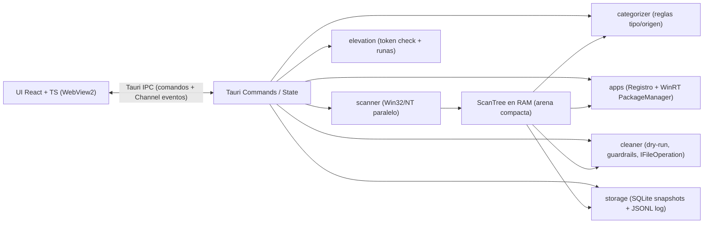

# Plan de Arquitectura e Implementación — ScanCleaner

## 1. Resumen y alcance (MVP y backlog)

**Objetivo**: Aplicación de escritorio ligera para Windows 10/11 que analiza el uso de disco, visualiza jerárquicamente dónde se ocupa el espacio (carpetas, archivos, categorías y aplicaciones instaladas) y permite liberar espacio con salvaguardas estrictas contra el borrado accidental.

### Alcance del MVP (v1.0)
- **Escaneo de unidades**:
  - Listado de unidades fijas y removibles con espacio total, usado y libre (`GetDiskFreeSpaceExW`).
  - Listado de unidades de red (`DRIVE_REMOTE`) de forma asíncrona y escaneo únicamente bajo demanda para evitar bloqueos por timeouts de red.
  - Escaneo recursivo paralelo mediante enumeración Win32/NT con reporte de progreso throttled (~100 ms) y cancelación limpia (`AtomicBool`).
  - Manejo de casos especiales: registro de rutas con `ERROR_ACCESS_DENIED` sin abortar el escaneo (con opción de re-escanear como administrador), exclusión de symlinks y junctions (`FILE_ATTRIBUTE_REPARSE_POINT`, tamaño 0 y sin descender para evitar ciclos y conteo doble), deduplicación de hardlinks por `FileId` en volúmenes NTFS y detección de placeholders de OneDrive (`IO_REPARSE_TAG_CLOUD*`) usando tamaño asignado en disco (*allocated size*).
- **Visualización**:
  - **Treemap squarified** interactivo renderizado en Canvas 2D (drill-down por clic, barra de breadcrumb, botón volver/subir, tooltip informativo y menú contextual con "Abrir en Explorador" / "Enviar a limpieza").
  - **Ranking** de las carpetas y archivos más grandes (Top N con ordenamiento, filtros y listas virtualizadas).
  - **Vista por categoría** con gráfico de distribución por tipo de archivo y por origen.
- **Categorización**:
  - Por tipo: video, imagen, audio, documentos, comprimidos, ejecutables/instaladores, código, otros.
  - Por origen: aplicaciones instaladas, sistema (WinSxS, `pagefile.sys`, `hiberfil.sys`, etc.), temporales, cachés de navegadores, artefactos de desarrollo (`node_modules`, `vendor`, `.venv`, `bin`/`obj`, `target`, cachés de npm/pip/composer), Papelera y Descargas.
  - Reglas predefinidas embebidas + soporte de personalización y overrides en archivo JSON del usuario (`%APPDATA%\ScanCleaner\rules.json`).
- **Aplicaciones instaladas**:
  - Listado combinado de apps Win32 desde `HKLM\SOFTWARE\Microsoft\Windows\CurrentVersion\Uninstall`, `HKLM\SOFTWARE\WOW6432Node\Microsoft\Windows\CurrentVersion\Uninstall` y `HKCU\SOFTWARE\Microsoft\Windows\CurrentVersion\Uninstall`.
  - Listado de apps Store/MSIX vía WinRT `PackageManager::FindPackagesForUser("")`.
  - Cálculo de tamaño real en disco cuando sea verificable (reutilizando el `ScanTree` si la unidad fue escaneada o medición acotada bajo demanda, evitando atribuir carpetas compartidas como `Program Files` completo), indicando explícitamente *"Medido en disco"* frente a *"Estimado"*.
  - Desinstalación **siempre** mediante el flujo nativo de Windows: ejecución de `UninstallString` del registro o apertura de `ms-settings:appsfeatures`. Prohibido borrar manualmente la carpeta de una aplicación.
- **Limpieza segura**:
  - Acciones en MVP: temporales de usuario (`%TEMP%`) y de sistema (`C:\Windows\Temp` cuando está elevado), Papelera (`SHEmptyRecycleBinW`), cachés de navegadores (Chrome/Edge/Brave/Firefox, con detección de procesos activos), artefactos de desarrollo (`node_modules`, `vendor`, `.venv`, `bin`/`obj`, `target`, cachés de gestores con indicador de antigüedad) y filtro de archivos grandes y antiguos (`LastWriteTime`).
  - Salvaguardas: vista previa *dry-run* obligatoria con resumen exacto de rutas y bytes a liberar, confirmación explícita del usuario, envío a la Papelera por defecto (`IFileOperation`, sin degradación silenciosa a borrado permanente; borrado permanente solo opcional con segunda confirmación), lista negra inmutable de rutas protegidas del sistema y registro auditable en JSONL.
- **Permisos**:
  - Ejecución por defecto sin privilegios (`asInvoker`) + botón "Reiniciar como administrador" bajo demanda (`ShellExecuteExW` con verbo `"runas"`), con indicador visual claro en la barra superior.
- **Persistencia básica**:
  - Base de datos SQLite embebida guardando **snapshots agregados** al finalizar cada escaneo (totales por unidad, por categoría y carpetas principales) para consultar historial y variación de espacio en el tiempo sin inflar el uso de disco.

### Backlog (Post-MVP)
- **v1.1**:
  - Visualización **Sunburst** interactiva complementaria al Treemap.
  - **Buscador de archivos duplicados** en 3 etapas (agrupación por tamaño exacto → hash parcial 4 KB inicio/fin → hash completo con BLAKE3).
  - Comparativa visual detallada entre dos snapshots históricos (qué carpetas crecieron más entre fecha A y fecha B).
- **v2.0**:
  - **Motor turbo `$MFT`** opcional para volúmenes NTFS locales cuando la aplicación corre elevada (con fallback automático al motor normal para no-NTFS o sin admin).
  - Integración segura con limpieza oficial de componentes de Windows mediante invocación explícita de `Dism.exe /Online /Cleanup-Image /StartComponentCleanup` (nunca borrando `WinSxS` directamente).
  - Editor visual de reglas de categorización en la UI.
  - Arquitectura opcional con proceso *helper* elevado desacoplado (para aislar WebView2 sin privilegios de administrador) y firma de código con Azure Trusted Signing para distribución pública.

---

## 2. Stack elegido y alternativas descartadas

### Stack elegido: **Tauri v2 (Rust + React 19 + TypeScript + Vite)**
- **Backend (Rust)**:
  - `windows` (`windows-rs`): binding oficial de Microsoft para Win32 (`FindFirstFileExW`, `NtQueryDirectoryFile`, `GetDiskFreeSpaceExW`, `GetCompressedFileSizeW`, Registro, `ShellExecuteExW`, `SHGetKnownFolderPath`, `SHEmptyRecycleBinW`, `GetTokenInformation`), COM (`IFileOperation`) y WinRT (`Windows.Management.Deployment.PackageManager`).
  - `rayon` / pool acotado de hilos para escaneo paralelo con límite de concurrencia adaptable según tipo de disco.
  - `rusqlite` (feature `bundled`) para snapshots históricos en SQLite sin dependencias externas.
- **Frontend (React + TypeScript)**:
  - Canvas 2D personalizado para el Treemap squarified (mantiene 60 fps con cientos de rectángulos visibles sin saturar el DOM).
  - `@tanstack/react-virtual` para tablas virtualizadas de ranking, aplicaciones instaladas y visor de logs.
  - Comunicación IPC paginada/proyectada con Rust (`invoke` + `tauri::ipc::Channel`): el árbol completo nunca se serializa ni se envía entero a JavaScript.
- **Distribución y firma**:
  - **Instalador NSIS** (`.exe`) + **versión Portable** (`.zip`).
  - Sin firma de código EV en la etapa inicial (se documentará en el `README.md` el aviso esperado de Windows SmartScreen en binarios sin firmar y se dejarán preparados los hooks de compilación para integrar **Azure Trusted Signing** antes de distribución pública).

### Alternativas descartadas
| Alternativa | Motivo de descarte |
| :--- | :--- |
| **Electron (Node + React)** | Binario pesado (~120–200+ MB) y consumo base elevado de RAM. El escaneo en Node puro (`libuv`) y la manipulación de millones de objetos JS no escalan para discos >1 TB, lo que obligaría igualmente a construir addons nativos (C++/Rust) o invocar PowerShell para Registro, COM y WinRT. |
| **.NET 8/9 (WPF / WinUI 3)** | Excelente acceso a APIs Windows, pero no aprovecha la experiencia previa en React/TS y carece de componentes nativos avanzados para treemaps interactivos, requiriendo dibujar con SkiaSharp o incrustar WebView2 igualmente. |
| **Empaquetado MSIX** | El modelo de virtualización de sistema de archivos y registro de MSIX, junto con sus restricciones de elevación, interfiere con el escaneo global de unidades, lectura directa de `HKLM` y limpieza de rutas del sistema. Por ello se elige **NSIS + Portable**. |

---

## 3. Arquitectura y flujo de datos



### Responsabilidades por módulo (`src-tauri/src/`) y detalles de APIs Windows
1. **`scanner`**:
   - Lista volúmenes locales (`GetLogicalDrives`, `GetDriveTypeW`, `GetDiskFreeSpaceExW`) evitando sondear unidades de red de forma bloqueante al inicio.
   - Recorre directorios en paralelo usando `NtQueryDirectoryFile(FileIdBothDirectoryInformation)` en volúmenes NTFS para obtener `FileId` y `AllocationSize` en la misma llamada de directorio, con fallback automático a `FindFirstFileExW` en sistemas de archivos donde `FileIdBothDirectoryInformation` no esté soportado o devuelva `FileId = 0` (FAT32, exFAT, SMB).
   - **Validación empírica requerida en Fase 1**: comprobar si `AllocationSize` de `FileIdBothDirectoryInformation` refleja siempre el espacio real en disco para archivos comprimidos NTFS, archivos *sparse* y placeholders de OneDrive (`FILE_ATTRIBUTE_RECALL_ON_DATA_ACCESS`), o si debe invocarse `GetCompressedFileSizeW` selectivamente cuando aparezcan esos atributos.
   - Construye `ScanTree` en RAM, emite eventos de progreso cada ~100 ms vía `tauri::ipc::Channel` y acumula rutas `ERROR_ACCESS_DENIED`.
2. **`categorizer`**:
   - Clasifica cada nodo por extensión (`TypeCategory`) y por origen (`OriginCategory`) resolviendo rutas reales del usuario mediante `SHGetKnownFolderPath` (Descargas, Documentos, Temp, AppData, etc.) y fusionando reglas embebidas con `%APPDATA%\ScanCleaner\rules.json` (validado con esquema seguro).
   - Ejecuta una pasada agregada *bottom-up* al finalizar el escaneo para calcular totales por categoría sin recorrer nuevamente el árbol en cada consulta de UI.
3. **`apps`**:
   - Consulta `Uninstall` en `HKLM` (64-bit y `WOW6432Node`) y `HKCU`, filtrando `SystemComponent=1`, actualizaciones (`ParentKeyName`) y entradas sin `DisplayName`.
   - Consulta apps Store/MSIX vía `PackageManager::FindPackagesForUser("")` filtrando paquetes de framework/sistema.
   - Mide tamaño real en disco de forma conservadora (usando `ScanTree` si la unidad ya fue escaneada o conteo acotado si la carpeta de instalación es exclusiva de la app; si la ruta es compartida como `C:\Program Files`, marca como *"Estimado"* para no atribuir gigabytes ajenos).
   - Ejecuta desinstalación exclusivamente lanzando `UninstallString` (parseando ejecutable y argumentos de forma segura) o abriendo `ms-settings:appsfeatures` para MSIX.
4. **`cleaner`**:
   - Valida todo objetivo contra la lista negra inmutable, verifica que no existan symlinks/junctions en la ruta objetivo o sus padres inmediatos, detecta navegadores abiertos y usa `LastWriteTime` (evitando `LastAccessTime`, que suele estar desactivado o alterado por antivirus/indexadores en Windows 10/11) para filtrar archivos antiguos.
   - Genera un `CleanupPlan` (*dry-run*) con conteo exacto de ítems, bytes recuperables, advertencias y método de borrado.
   - Tras confirmación explícita en UI, ejecuta la eliminación en un hilo dedicado inicializado como **COM STA** (`CoInitializeEx(..., COINIT_APARTMENTTHREADED)`) usando `IFileOperation` para enviar a la Papelera por defecto, o `SHEmptyRecycleBinW` para vaciar la Papelera.
   - Registra cada operación (éxitos, omitidos, errores) en `%APPDATA%\ScanCleaner\logs\cleanup-YYYY-MM-DD.jsonl` y actualiza o invalida los nodos afectados en `ScanTree`.
5. **`elevation`**:
   - Inspecciona el token del proceso actual con `GetTokenInformation(TokenElevation)`.
   - Si el usuario solicita elevar, relanza el ejecutable actual mediante `ShellExecuteExW` con `lpVerb = "runas"`, pasando la unidad activa por argumento CLI y cerrando la instancia sin privilegios al confirmarse el lanzamiento.
   - **Validación empírica requerida en Fase 0/5**: verificar el aislamiento de `userDataFolder` de WebView2 cuando Tauri v2 corre elevado para evitar que archivos creados con ACLs de administrador bloqueen el arranque posterior en modo normal; si comparten ruta por defecto, configurar un `userDataFolder` separado en modo elevado.
6. **`storage`**:
   - Administra la base SQLite (`%APPDATA%\ScanCleaner\history.db`) con migraciones versionadas para guardar snapshots agregados y consultar series temporales por unidad.
   - Provee lectura paginada de los logs JSONL de limpieza.
7. **`UI` (`src/`)**:
   - Invoca vistas proyectadas desde `ScanTree`: `get_treemap_children(node_id, max_items)`, `get_top_entries(scope, limit)`, `get_category_breakdown()`, `list_apps()`, `preview_cleanup(targets)`, `execute_cleanup(plan_id)`.

---

## 4. Modelo de datos del árbol escaneado

Para manejar discos de >1 TB (1 a 3 millones de archivos) con uso moderado de RAM (~150–300 MB en lugar de varios GB), el árbol en Rust utiliza una **arena plana indexada por `u32`** (`NodeId`) y un **buffer contiguo de nombres UTF-8** (sin almacenar la ruta completa en cada nodo; la ruta se reconstruye ascendiendo por `parent` solo bajo demanda).

```rust
pub type NodeId = u32;

pub struct ScanTree {
    pub root_path: PathBuf,          // ej. "C:\\"
    pub volume_serial: u32,
    pub fs_type: FileSystemType,     // Ntfs | Fat32 | ExFat | Refs | Network | Unknown
    pub nodes: Vec<FsNode>,          // índice == NodeId
    pub name_arena: String,          // nombres concatenados en UTF-8
    pub access_denied: Vec<PathBuf>, // rutas omitidas por falta de permisos
    pub stats: ScanStats,            // duración, total archivos/dirs, hardlinks deduplicados, placeholders
}

pub struct FsNode {
    pub parent: Option<NodeId>,
    pub first_child: Option<NodeId>, // lista enlazada de hijos (evita millones de Vec)
    pub next_sibling: Option<NodeId>,
    pub name_offset: u32,
    pub name_len: u16,
    pub kind: NodeKind,              // Dir | File | Symlink | Junction | CloudPlaceholder
    pub logical_size: u64,           // suma recursiva en directorios
    pub allocated_size: u64,         // espacio real en disco (deduplicado en hardlinks)
    pub last_write_ts: i64,          // Unix timestamp (UTC)
    pub file_count: u32,             // archivos descendientes (solo dirs)
    pub type_cat: TypeCategory,      // u8 enum (Video, Image, Code, ...)
    pub origin_cat: OriginCategory,  // u8 enum (DevArtifact, BrowserCache, System, ...)
    pub flags: NodeFlags,            // bitflags: HARDLINK_DUP, COMPRESSED, SPARSE, CLOUD_ONLY, PROTECTED
}
```

- **Eficiencia de memoria**: cada `FsNode` ocupa ~56–64 bytes; 2 millones de nodos consumen ~120–130 MB más ~60 MB en `name_arena`. La lista enlazada `first_child`/`next_sibling` elimina millones de asignaciones en heap de `Vec<NodeId>`.
- **Proyección hacia React**: los comandos IPC devuelven DTOs livianos para el nodo visualizado en el Treemap (top ~150 hijos/agrupaciones más grandes por tamaño asignado, consolidando el resto en un bloque sintético *"Otros (N elementos)"*).

---

## 5. Matriz de permisos (función → requiere admin)

| Funcionalidad | ¿Requiere Admin? | Comportamiento sin Admin (`asInvoker`) | Comportamiento con Admin (elevado) |
| :--- | :---: | :--- | :--- |
| Listar unidades fijas y removibles | **No** | Completo. | Completo. |
| Listar/escanear unidades de red mapeadas | **No** | Completo (bajo demanda). | Puede no ver unidades mapeadas del usuario normal (limitación UAC *split token* si no existe `EnableLinkedConnections`). |
| Escanear perfil de usuario, Descargas, proyectos, USB | **No** | Completo. | Completo. |
| Escanear `C:\Windows`, `ProgramData`, otros perfiles, `System Volume Information` | **Parcial / Sí** | Escanea lo legible y registra rutas bloqueadas en "Omitidas por permisos". | Acceso amplio (las rutas exclusivas de `SYSTEM`/`TrustedInstaller` se siguen reportando si deniegan lectura). |
| Treemap, Ranking, Categorización y snapshots SQLite | **No** | Completo. | Completo. |
| Listar apps Win32 (`HKLM`, `WOW6432Node`, `HKCU`) | **No** | Lectura completa de claves de desinstalación. | Completo. |
| Listar apps Store/MSIX (`FindPackagesForUser("")`) | **No** | Completo para el usuario actual. | Completo (precaución: en *over-the-shoulder UAC* consultará el perfil de la cuenta admin que autorizó el UAC). |
| Medir tamaño real en `C:\Program Files\WindowsApps` | **Sí (parcial)** | Marca como *"Estimado / acceso restringido"* si devuelve `AccessDenied`. | Mayor acceso (algunas subcarpetas mantienen ACLs exclusivas del sistema). |
| Lanzar desinstalador nativo / `ms-settings:appsfeatures` | **No** | Windows solicita UAC automáticamente cuando el desinstalador lo requiere. | Igual. |
| Limpiar `%TEMP%`, cachés de navegadores, dev artifacts, archivos de usuario, Papelera | **No** | Completo (salvo archivos bloqueados por procesos en ejecución). | Completo. |
| Limpiar `C:\Windows\Temp` o cachés de sistema | **Sí** | Muestra candado y botón "Reiniciar como admin". | Habilitado (sujeto siempre a la lista negra inmutable). |
| Motor turbo `$MFT` (v2.0) | **Sí** | No disponible; utiliza enumeración Win32/NT estándar. | Disponible para volúmenes NTFS locales. |

---

## 6. Riesgos y mitigaciones

### A. Riesgos de borrado accidental (críticos)
1. **Borrado de rutas críticas del sistema o carpetas raíz del usuario**
   - *Mitigación*: lista negra **inmutable** en Rust validada antes de construir cualquier `CleanupPlan` y re-validada justo antes de ejecutar la eliminación. Incluye: raíces de unidad (`X:\`), `Windows`, `Windows\WinSxS`, `Windows\System32`, `Program Files`, `Program Files (x86)`, `ProgramData`, `System Volume Information`, `Boot`, `Recovery`, `$Recycle.Bin`, `pagefile.sys`, `hiberfil.sys`, `swapfile.sys`, raíz de `C:\Users`, raíz de `%USERPROFILE%`, y carpetas base de Documentos/Escritorio/Imágenes como objetivo completo. Toda comparación normaliza mayúsculas/minúsculas, resuelve segmentos `..`, canonicaliza y contempla el prefijo extendido `\\?\`.
2. **Traversal / TOCTOU mediante symlinks o junctions**
   - *Mitigación*: verificar `FILE_ATTRIBUTE_REPARSE_POINT` antes de planificar y antes de borrar cada ítem; prohibir seguir o eliminar el destino de un symlink/junction cuando se limpia un árbol.
3. **Borrado permanente silencioso cuando la Papelera rechaza un ítem** (archivos mayores a la cuota de la Papelera o unidades sin Papelera)
   - *Mitigación*: configurar `IFileOperation` para que **nunca** degrade silenciosamente a borrado permanente. Si el envío a Papelera falla o no está soportado, abortar ese ítem, informarlo en el resumen de resultados y requerir confirmación explícita del usuario para borrado permanente. *(Se validarán empíricamente en Fase 4 los flags exactos `FOF_ALLOWUNDO | FOFX_RECYCLEONDELETE | FOFX_EARLYFAILURE` sobre Windows 10/11).*
4. **Corrupción de perfiles de navegadores o pérdida de trabajo reciente**
   - *Mitigación*: apuntar exclusivamente a subcarpetas de caché verificadas (jamás `Cookies`, `Login Data`, `Bookmarks`, historiales o bases SQLite de sesión), alertar si el proceso del navegador (`chrome.exe`, `msedge.exe`, `firefox.exe`, etc.) está en ejecución y resaltar en UI los artefactos de desarrollo con modificaciones recientes (<7 días).
5. **Desinstalación corrupta de aplicaciones**
   - *Mitigación*: prohibido eliminar `InstallLocation` manualmente; toda desinstalación delega en `UninstallString` o `ms-settings:appsfeatures`.

### B. Riesgos de rendimiento en discos >1 TB y comportamiento de APIs Windows
1. **Agotamiento de memoria o bloqueo de la UI con millones de archivos**
   - *Mitigación*: arena compacto (`FsNode` ~64 bytes), emisión throttled de progreso (~100 ms), IPC estrictamente proyectado por subárbol y renderizado en Canvas 2D + tablas virtualizadas.
2. **Degradación severa en discos mecánicos (HDD) por exceso de hilos**
   - *Mitigación*: concurrencia adaptativa/acotada por volumen (evitando saturar colas de I/O aleatorias en HDDs) y límite configurable.
3. **Conteo doble por hardlinks (`WinSxS`), archivos dispersos o OneDrive**
   - *Mitigación*: deduplicación por `FileId` en NTFS y contabilidad por `allocated_size`. Los puntos pendientes de validación empírica en Fase 1 (`AllocationSize` vs `GetCompressedFileSizeW` y respuesta exacta de `FileIdBothDirectoryInformation` en FAT32/exFAT/SMB) se probarán contra casos reales antes de cerrar la fase.
4. **Conflictos de perfil de WebView2 al elevar con UAC**
   - *Mitigación*: validar en Fase 0/5 el comportamiento de `userDataFolder` de Tauri v2 bajo token elevado y aislarlo en una subcarpeta dedicada si se detectan problemas de permisos al volver a modo normal.

---

## 7. Fases de implementación, estrategia de testing y criterios de aceptación

### Estándares del repositorio y CI
- **Backend Rust**: `cargo fmt --check` y `cargo clippy --all-targets -- -D warnings`.
- **Frontend TS/React**: **Biome** (linter + formatter), `tsc --noEmit` y **Vitest**.
- **Commits**: Conventional Commits (`feat:`, `fix:`, `docs:`, `chore:`, `test:`, `refactor:`).
- **CI (GitHub Actions)**: workflow en `windows-latest` ejecutando verificación de formato, lint, typecheck, tests unitarios/integración sandbox y compilación de prueba en cada push/PR.

### Estrategia de testing sin riesgo sobre datos reales
- **Tests unitarios**: reglas de `categorizer`, lógica de `Guardrails` / lista negra (casos con `..`, casing mixto, `\\?\`, rutas protegidas), parsing seguro de `UninstallString`, cálculo de agregados de `ScanTree` y manejo de snapshots SQLite.
- **Tests de integración en sandbox (`src-tauri/tests/sandbox_fixtures.rs`)**: creación automática de un árbol aislado en `tempfile::TempDir` con:
  - Archivos normales y archivos *sparse* reales (`FSCTL_SET_SPARSE`).
  - Hardlinks reales (`CreateHardLinkW`) apuntando al mismo archivo para verificar conteo único.
  - Junctions apuntando a un directorio padre (ciclo) y a una ruta fuera del sandbox para verificar que no hay bucle infinito ni escape.
  - Subdirectorio con ACL restrictiva temporal (o simulación controlada) para verificar reporte de `AccessDenied`.
- **Barrera de seguridad en tests de limpieza (`SandboxGuard`)**: toda ejecución de `cleaner` en tests automatizados valida que cada ruta objetivo resida dentro del `TempDir` del test. Las pruebas reales contra `IFileOperation` / Papelera de Windows se marcan con `#[ignore]` para ejecución manual controlada.

---

### Fases de implementación

#### Fase 0: Bootstrap del repo, estándares y CI
- **Tareas**:
  - Inicializar proyecto Tauri v2 con React 19, TypeScript, Vite, Biome y Vitest.
  - Configurar estructura de módulos Rust en `src-tauri/src/` y reglas estrictas de `clippy`.
  - Crear `.github/workflows/ci.yml` en `windows-latest`.
  - Validar detección de token (`TokenElevation`) y comportamiento de `userDataFolder` de WebView2 al correr elevado.
- **Criterios de aceptación**:
  - `cargo fmt --check`, `cargo clippy -- -D warnings`, `cargo test`, `biome check`, `tsc --noEmit` y build base de Tauri pasan en verde localmente y en CI (`windows-latest`).

#### Fase 1: Motor de escaneo + Modelo de datos + Fixtures de integración
- **Tareas**:
  - Implementar enumeración de unidades (fijas, removibles y red bajo demanda).
  - Implementar `ScanTree` (arena de nodos + `name_arena`) y scanner paralelo Win32/NT con progreso vía `Channel` y cancelación.
  - Validar empíricamente `AllocationSize` / `GetCompressedFileSizeW` y fallback `FindFirstFileExW` para FAT32/exFAT/SMB.
  - Implementar suite `sandbox_fixtures.rs` con hardlinks, junctions con ciclo, archivos *sparse* y rutas sin permisos.
- **Criterios de aceptación**:
  - Los tests de `sandbox_fixtures.rs` verifican tamaño exacto (hardlink contado 1 vez, ciclo sin bucle infinito y tamaño 0, ruta sin acceso registrada sin abortar).
  - La cancelación detiene los workers en menos de 500 ms.
  - El escaneo de un disco real (>500k archivos) mantiene UI fluida y consumo de RAM acotado.

#### Fase 2: Visualización core (Treemap, Ranking y Categorización)
- **Tareas**:
  - Implementar `categorizer` (reglas embebidas de tipo/origen + `SHGetKnownFolderPath` + carga/validación de `%APPDATA%\ScanCleaner\rules.json`).
  - Exponer comandos IPC proyectados (`get_treemap_children`, `get_top_entries`, `get_category_breakdown`).
  - Construir `TreemapCanvas.tsx` (algoritmo squarified, drill-down, breadcrumb, botón volver, menú contextual) + `TopEntriesTable.tsx` virtualizada + `CategoryCharts.tsx`.
- **Criterios de aceptación**:
  - Navegación fluida (60 fps) por 10+ niveles de profundidad en el Treemap sin congelar la UI.
  - La suma de bytes por categoría coincide exactamente con el total asignado del árbol escaneado.
  - Modificar `%APPDATA%\ScanCleaner\rules.json` recategoriza los elementos tras re-escanear.

#### Fase 3: Aplicaciones instaladas
- **Tareas**:
  - Implementar lectura de `Uninstall` (HKLM, WOW6432Node, HKCU) y WinRT `PackageManager::FindPackagesForUser("")`.
  - Implementar filtro de componentes internos y cálculo conservador de tamaño real (*"Medido en disco"* vs *"Estimado"*).
  - Implementar lanzador seguro de desinstaladores nativos (`UninstallString` y `ms-settings:appsfeatures`) y vista `AppsView.tsx`.
- **Criterios de aceptación**:
  - Lista apps Win32 y MSIX sin requerir privilegios de administrador.
  - Ninguna app instalada en carpetas compartidas se atribuye el tamaño de aplicaciones vecinas.
  - La acción de desinstalar invoca exclusivamente el flujo nativo de Windows y jamás elimina archivos directamente.

#### Fase 4: Motor de limpieza segura + Logs
- **Tareas**:
  - Implementar `Guardrails` (lista negra inmutable canonicalizada + verificación anti-reparse-point + `SandboxGuard` para tests).
  - Implementar detectores de limpieza (temporales, Papelera, cachés de navegadores con aviso de proceso activo, dev artifacts con antigüedad, archivos grandes/antiguos por `LastWriteTime`).
  - Implementar flujo `preview_cleanup` (dry-run) → `CleanupModal.tsx` → `execute_cleanup` vía `IFileOperation` (hilo COM STA) / `SHEmptyRecycleBinW`.
  - Validar empíricamente flags de `IFileOperation` para impedir degradación silenciosa a borrado permanente.
  - Implementar escritor y visor de logs JSONL (`cleanup-YYYY-MM-DD.jsonl`).
- **Criterios de aceptación**:
  - Tests unitarios rechazan el 100 % de intentos sobre rutas protegidas (incluyendo rutas con `..`, casing mixto, `\\?\` y junctions apuntando a rutas del sistema).
  - Test de integración en `TempDir` verifica coincidencia entre dry-run, archivos eliminados y registro JSONL.
  - Si el envío a Papelera falla, no se produce borrado permanente silencioso.

#### Fase 5: Elevación UAC, Persistencia (SQLite) y Empaquetado
- **Tareas**:
  - Implementar `elevation` (`TokenElevation` + `ShellExecuteExW("runas")` preservando unidad activa) y `ElevationBanner.tsx`.
  - Implementar `storage` SQLite con snapshots agregados al cerrar escaneo y vista `HistoryView.tsx` (evolución histórica y logs).
  - Configurar bundler Tauri para **NSIS** y **Portable (.zip)** en `tauri.conf.json` y CI.
  - Documentar en `README.md` uso, permisos y aviso esperado de SmartScreen para builds sin firma.
- **Criterios de aceptación**:
  - Relanzar como administrador conserva la unidad seleccionada y habilita la limpieza de `C:\Windows\Temp`.
  - Al reiniciar la app persiste el historial de snapshots y se muestra la variación entre escaneos.
  - Los artefactos NSIS y Portable se generan en CI y arrancan correctamente en Windows 10 y Windows 11.

---

## 8. Estructura inicial del repo

```text
scancleaner-app/
├── .github/
│   └── workflows/
│       └── ci.yml                 # windows-latest: fmt, clippy, cargo test, biome, tsc, vitest, build
├── docs/
│   └── PLAN.md                    # Plan de arquitectura e implementación aprobado
├── src/                           # Frontend React + TypeScript (Vite)
│   ├── components/
│   │   ├── TreemapCanvas.tsx      # Treemap squarified en Canvas 2D + drill-down
│   │   ├── BreadcrumbBar.tsx      # Navegación jerárquica
│   │   ├── TopEntriesTable.tsx    # Ranking virtualizado
│   │   ├── CategoryCharts.tsx     # Distribución por tipo y origen
│   │   ├── CleanupModal.tsx       # Dry-run y confirmación explícita
│   │   └── ElevationBanner.tsx    # Indicador de privilegios + botón UAC
│   ├── pages/
│   │   ├── DrivesView.tsx         # Listado de unidades fijas, removibles y red
│   │   ├── ExplorerView.tsx       # Treemap + Ranking + Categorías
│   │   ├── AppsView.tsx           # Aplicaciones Win32 + Store/MSIX
│   │   ├── CleanerView.tsx        # Temporales, cachés, dev artifacts, grandes/antiguos
│   │   └── HistoryView.tsx        # Snapshots SQLite + visor de logs JSONL
│   ├── lib/
│   │   └── ipc.ts                 # Wrappers tipados de invoke() y Channels Tauri
│   ├── App.tsx
│   └── main.tsx
├── src-tauri/                     # Backend Rust (Tauri v2)
│   ├── Cargo.toml
│   ├── tauri.conf.json            # Config NSIS + portable + manifest asInvoker
│   ├── src/
│   │   ├── main.rs
│   │   ├── lib.rs
│   │   ├── state.rs               # Estado compartido (ScanTree activo, cancel token, DB)
│   │   ├── commands/              # Handlers IPC agrupados por dominio
│   │   ├── scanner/               # Unidades, recorrido Win32/NT, ScanTree arena
│   │   ├── categorizer/           # Reglas tipo/origen + rules.json
│   │   ├── apps/                  # Registry Win32 + WinRT PackageManager + tamaño real
│   │   ├── cleaner/               # Guardrails, lista negra, dry-run, IFileOperation, logs
│   │   ├── elevation/             # Detección de token + runas
│   │   └── storage/               # SQLite snapshots + lector/escritor JSONL
│   └── tests/                     # Tests de integración en sandbox TempDir
│       └── sandbox_fixtures.rs
├── biome.json
├── package.json
├── tsconfig.json
└── README.md
